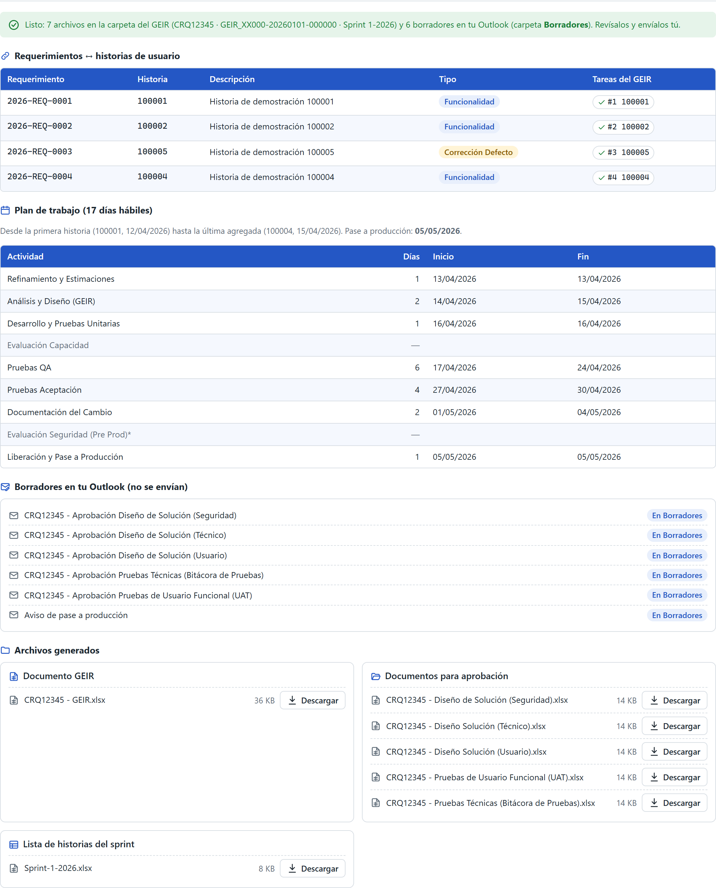
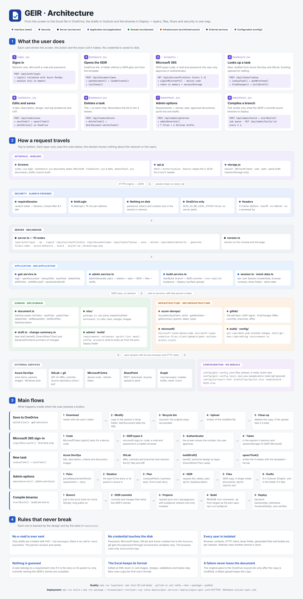

# GEIR

**Change-management paperwork that writes itself.**

Before a release can go to production, someone has to fill in the change document, relate every
requirement to its user story, work out a plan in business days, prepare approval documents,
write the approval e-mails and collect the binaries. GEIR does all of it from the sources that
already know the answer: Azure DevOps, GitLab and OneDrive.



## What it does

| You give it | It gives you |
| --- | --- |
| A task ID | A draft of the task in the 4-sheet Excel document: benefit, functional and technical design by layer, Given/When/Then cases, read from the work item and its merge requests |
| Requirement ↔ story pairs | Request IDs, labels and a work plan in business days, skipping weekends and holidays |
| A change name | One single-sheet approval workbook per approver and the sprint list |
| Nothing else | The approval e-mails as **drafts in your own Outlook**, each with its attachment. It never sends anything |
| A branch name | Only the Maven and front-end projects touched by the commits of *this* change, compiled and placed in a `Deploy` folder next to the document |

## Try it

No VPN, accounts or servers needed: the demo mode uses sample data.

```bash
npm install
npm run demo     # http://localhost:4300 (any user and password)
```

The interface is in Spanish.

## Use it with your own services

```bash
cp .env.example .env.local    # your Azure DevOps, GitLab and SharePoint
npm start
```

Your people, e-mail addresses and signature go in `config/geir.config.local.json`, which is
git-ignored and applied on top of `config/geir.config.json`.

## Good to know

- **Excel stays intact.** The workbook is edited at XML level, so in-cell images, merges,
  validations and styles survive.
- **Nothing is guessed.** A task belongs to a requirement only if it is the story or its parent
  is; only commits that name the document's stories get compiled.
- **No credentials on disk.** Passwords and tokens live in the session's memory and the browser's
  `sessionStorage`. Each user is isolated on a shared server.
- **A failure never loses the document.** The original goes to the recycle bin only after the
  copy has been modified.

Stack: Node.js, Express, TypeScript, React, Playwright, Microsoft Graph. `npm test` runs 32 unit
tests.

Everything else (layers, files, flows, security, configuration, API and deployment):
[docs/ARCHITECTURE.md](docs/ARCHITECTURE.md)


