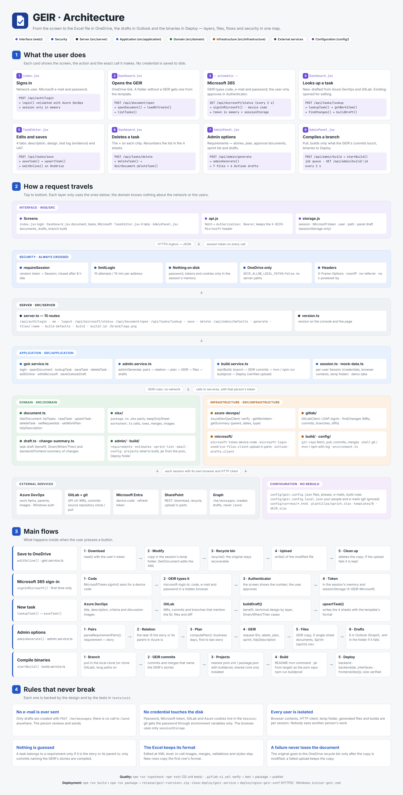

# GEIR · Architecture and how it works



GEIR fills the **GEIR** documentation (a 4-sheet Excel workbook in OneDrive) with data from
**Azure DevOps** and **GitLab**. Its *Opciones de administrador* (admin options) prepare the
approval documents, the sprint list, the Outlook e-mail **drafts** (never sent) and the
compiled binaries of the change in a `Deploy` folder.

It is a **Node.js + Express** server with a **React 15** interface. It runs on one person's PC
or on a **shared Linux server** used by several people.

> The user interface and its messages are in Spanish; this documentation and the code are in
> English. UI labels are quoted as they appear on screen.

---

## 1. Getting started

```bash
npm install
npm run demo        # sample data, no VPN → http://localhost:4300
npm start           # with your own services (configure .env.local first)
npm test            # unit tests
```

In demo mode any user and password work, and a local path to an Excel file can be used
(for example `C:\Users\me\Downloads\N - GEIR.xlsx`).

---

## 2. The layers (the main idea)

The code is split into layers. **Each layer only uses the ones below it**: a change in GitLab
does not touch the Excel rules, and the Excel rules can be tested without a network.

| Layer | Folder | What it does | Example |
| --- | --- | --- | --- |
| Interface | `web/src` | Screens in the browser | *Buscar* button |
| Server | `src/server` | Receives HTTP requests and checks the session | `POST /api/tasks/lookup` |
| Application | `src/application` | Use cases: coordinates everything | `lookupTask()` |
| Domain | `src/domain` | GEIR and Excel rules, **no network** | `GeirDocument.upsertTask()` |
| Infrastructure | `src/infrastructure` | Talks to Azure DevOps, GitLab, Microsoft 365, git/Maven/npm | `GitLabClient.findChanges()` |

```
Browser ──HTTP/JSON──► server ──► application ──┬──► domain          (Excel, plan, e-mails, build plan)
                                                └──► infrastructure  (Azure, GitLab, Microsoft, git)
                                                            └──► your services
```

---

## 3. Folder structure

```
GEIR/
├── src/
│   ├── server/
│   │   ├── server.ts               /api routes, token session, login limit, headers, startup
│   │   └── version.ts              Version (console and page)
│   ├── application/
│   │   ├── geir.service.ts         Login, document, tasks, Microsoft 365, OneDrive, drafts
│   │   ├── admin.service.ts        Admin options
│   │   ├── build.service.ts        Compiles a branch and puts the binaries in Deploy (job queue)
│   │   ├── session.ts              Each user's session (memory) and background browser
│   │   └── mock-data.ts            Demo-mode data
│   ├── domain/
│   │   ├── document.ts             The GEIR's 4 sheets (read, write, delete, formatting)
│   │   ├── draft.ts                Builds a new task from Azure and GitLab data
│   │   ├── change-summary.ts       Summarizes changed files by layer (backend/frontend/DB/config)
│   │   ├── xlsx/
│   │   │   ├── package.ts          The .xlsx as a package: parts, relationships, keep one sheet
│   │   │   ├── worksheet.ts        Cells, rows, merges, images, row heights
│   │   │   └── refs.ts             A1 references ↔ numbers
│   │   ├── build/
│   │   │   └── projects.ts         Which projects the commits touch, order, command, Deploy folder
│   │   └── admin/
│   │       ├── config.ts           Reads config/geir.config.json and files in config/
│   │       ├── requirements.ts     Parses the REQ ↔ story pairs the admin pastes
│   │       ├── estimates.ts        Work plan in business days and date formats
│   │       ├── sprint-list.ts      Sprint-{sprint}.xlsx on top of the original template
│   │       └── email.ts            MIME e-mail + bodies from the Outlook templates
│   └── infrastructure/
│       ├── config/environment.ts   .env variables (no credentials)
│       ├── azure-devops/azure-devops.client.ts   Work items, parent, dates, images
│       ├── gitlab/gitlab.client.ts               LDAP login, MRs, commits, branches, diffs
│       ├── build/
│       │   ├── git-repo.ts         fetch, pull, checkout, commits and files of a branch
│       │   └── shell.ts            Runs git / mvn / npm and keeps their output in the log
│       └── microsoft/
│           ├── microsoft-token.ts        Per-user token (device code), in memory
│           ├── microsoft-login.ts        Types code, e-mail and password on Microsoft's page
│           ├── onedrive-files.client.ts  Read, upload (in parts) and recycle in SharePoint
│           └── outlook-drafts.client.ts  Creates drafts with Microsoft Graph
├── web/
│   ├── index.html · styles.css
│   └── src/
│       ├── index.jsx        Login and app start
│       ├── Dashboard.jsx    Document, tasks, Microsoft sign-in
│       ├── TaskEditor.jsx   The 4 tabs of a task
│       ├── AdminPanel.jsx   Admin options (documents, drafts, branch build)
│       ├── api.js           Calls to the server
│       ├── storage.js       sessionStorage
│       ├── icons.jsx        Icons and logo
│       └── version.js       Interface version
├── config/                  Changed without compiling (see section 7)
├── templates/N - GEIR.xlsx  Empty GEIR for new folders
├── tests/unit/              Tests (node:test)
├── scripts/                 build-web.js · package.js · build-template.ts
├── deploy/                  geir.service (systemd) · nginx-geir.conf · Dockerfile
├── docs/                    This document and architecture.png
├── .npmrc                   npm install without scripts (esbuild.exe is blocked on some corporate VMs)
├── .env.example · .gitlab-ci.yml · package.json · tsconfig*.json · README.md
```

---

## 4. The flows, step by step

Each flow says what the user does, which HTTP route is called and which files take part.

### 4.1 Sign in

1. The user types **network user**, **Microsoft e-mail** and **password** (`web/src/index.jsx`).
2. `api.js` → `POST /api/auth/login` (`server.ts`, with `limitLogin`: 10 attempts per 15 min).
3. `login()` (`geir.service.ts`) creates a `Session` and validates it against Azure DevOps
   (`AzureDevOpsClient.verify()`). A wrong password answers 401.
4. The server returns a **random token**. The browser keeps it in `sessionStorage`.
5. If the tab already had a Microsoft token for **the same e-mail**, it is sent with the login
   and reused (no new Authenticator approval).

### 4.2 Microsoft 365 sign-in (automatic)

Happens the first time OneDrive or Outlook is needed.

1. `withMicrosoft()` sees there is no token and calls `signInMicrosoft()`.
2. `MicrosoftToken.signIn()` asks Microsoft for a **device code**.
3. `microsoft-login.ts` opens a hidden browser (Edge on Windows, Chromium on Linux) and types
   the code, the e-mail and the password.
4. The screen (`Dashboard.jsx`, polling `GET /api/microsoft/status` every 2 s) shows the
   **Authenticator number**. The user only approves on the phone. If something fails, the code
   is shown to finish it by hand.
5. The token stays **in the session's memory**; the server sends it to the browser in the
   `X-GEIR-Microsoft` header to keep it in `sessionStorage`. It renews itself.

### 4.3 Open the GEIR document

1. The user pastes the OneDrive link (folder or Excel file) in `Dashboard.jsx`.
2. `POST /api/document/open` → `openDocument()` → `locate()` (on a server only links are
   accepted; local paths are blocked) → `loadOrCreate()`.
3. `OneDriveFilesClient.read()` downloads the file. If the folder has no `N - GEIR.xlsx`, it is
   created from `templates/N - GEIR.xlsx`.
4. `GeirDocument.listTasks()` returns the tasks, shown as *chips* (`#7 100007 REQ-0101`).

### 4.4 Look up a task

`POST /api/tasks/lookup` → `lookupTask()`:

- **Already in the document**: `readTask()` reads it from the 4 sheets and opens it for editing.
- **New**:
  1. `AzureDevOpsClient.getWorkItem()`: title, description, criteria and discussion images.
  2. `GitLabClient.findChanges()`: merge requests, commits and branches that mention the ID,
     with their files and diffs. If GitLab's search finds nothing, it scans the last year's
     commits and the branches.
  3. `buildDraft()` (`draft.ts`) builds the task: benefit, functional design, **technical design
     by layer** (`change-summary.ts`) and *Dado / Cuándo / Entonces* (Given / When / Then) cases.
  4. `TaskEditor.jsx` opens with 4 tabs to review.

### 4.5 Save a task

1. `POST /api/tasks/save` → `saveTask()`.
2. `GeirDocument.upsertTask()` writes the task in the 4 sheets:

   | Sheet | What is written |
   | --- | --- |
   | Descripción Requerimiento | "Yo Quiero" (`N - REQ: ID - title`) and "Para Que" (benefit) |
   | Diseño Solución | block with functional, technical and security design |
   | Bitácora Pruebas Técnicas | evidence (image) and link to the task |
   | Plan de Pruebas UAT | case, Given, When, Then, result |

   When there is no room it inserts rows or blocks **copying the format** of the existing ones.
   `tidyDescription()` gives every line the B:J merge, style and height of the first one.
3. `editOnline()` saves to OneDrive (see 4.11).

### 4.6 Delete a task

The **×** on a chip → `POST /api/tasks/delete` → `deleteTask()` → `GeirDocument.deleteTask()`:
removes its rows and blocks from the 4 sheets and renumbers the following tasks.

### 4.7 Admin options

`AdminPanel.jsx` → `POST /api/admin/generate` → `adminGenerate()` (`admin.service.ts`).

1. **Data**: change name (CRQ), GEIR name, sprint and release date. Empty values become
   `TEMPORAL`.
2. **Pairs** (`requirements.ts`): one pair per line, e.g. `2026-REQ-0101 100002` or
   `2026-REQ-0101: 100002 - Title`, rows pasted from Excel, or a JSON array.
3. **No guessing**: with Azure DevOps' `getSummary()`, a GEIR task belongs to a requirement only
   if it **is** the story or its **parent** is the story. The rest are included **without a
   requirement** and shown as a warning.
4. **Work plan** (`estimates.ts`, `computePlan()`): in business days (no weekends or holidays),
   from the first story to the last one. Development takes the days in between; the other
   phases have fixed days from the configuration.
5. **Updated GEIR** (`document.ts`): *ID del Pedido*, requirement in front of each task in the 4
   sheets (`2026-REQ-0101: 100007 - Title`, or `100006 - Title` without requirement),
   *Plan de Trabajo*, sprint in *Descripción*, and `tidyDescription()`. Saved with `editOnline()`.
6. **Files in the same folder**:
   - `{cambio} - GEIR.xlsx` (copy).
   - 5 approval documents: the GEIR with **a single sheet** (`XlsxPackage.keepOnlySheet()`).
   - `Sprint-{sprint}.xlsx` (`sprint-list.ts`) on `config/plantillas/sprint.xlsx`, with **every**
     story of the document, with or without requirement.
7. **6 Outlook drafts** (`email.ts` + `outlook-drafts.client.ts`): 5 approvals, each with its
   document attached, and the production-changes FORO. The body comes from `config/correos/*.html` and its table has the same rows as the Sprint's sheet 2. Created with
   Microsoft Graph `POST /me/messages`. **Never sent.** If the mailbox does not answer, that
   e-mail is left as an `.eml` in the GEIR folder with a warning.
8. The screen shows the relation, the plan, the drafts and the files to download.

### 4.8 Compile a branch's binaries (Deploy)

*Rama* (branch) field of the admin panel → *Compilar binarios* button (or *Generar* when the
branch is filled in) → `POST /api/admin/build` → `startBuild()` (`build.service.ts`). Compiling
takes minutes, so it is a **queued job**: the screen polls `GET /api/admin/build/:id` every 2 s
and shows the step, the commits, the projects and the log.

1. **Repository** (`git-repo.ts`, `sourceFolder()`). The **local clone** is used first, in this
   order: the one typed in *Carpeta local del repositorio*, `GEIR_REPO_DIR`, or a folder named
   `GEIR_REPO_NAME` next to GEIR (`C:\dev\GEIR` → `C:\dev\<name>`, or the repository inside it).
   - With a local folder: `git fetch`, `checkout <branch>` and `git pull --ff-only`. If the
     folder has uncommitted changes it is **left untouched** and the user is told (only
     `package-lock.json`, rewritten by `npm install`, is restored).
   - Only when there is no local folder, GEIR clones `GITLAB_BASE_URL/<GEIR_REPO_PROJECT>.git`
     into `GEIR_REPOS_DIR` with the network user and password of whoever compiles (passed to
     the `git` process through environment variables; never to disk) and leaves the branch
     exactly as it is in GitLab.
   - Always with `core.longpaths=true`: Java repositories often have paths over Windows' 260-character limit.
2. **Only the GEIR's stories** (`geirIds()`): the IDs of the document's tasks, their parent
   stories in Azure DevOps and the stories typed in *Requerimientos*. Of the branch's commits
   that are not in the base (`ramaBase`, or GitLab's default branch), only the ones whose
   message **names one of those IDs** count (`mentionsAny()`: the whole number, `1000080` does
   not match `100008`). Only those commits' files are compiled. **Merges** count too: if the ID
   is only in the merge request's merge (`Merge branch 'feature/…' … 777777 …`), every file
   that merge brought is taken (`git diff merge^1 merge`). The table shows which project each
   commit touches; other commits are greyed out and **not compiled**. A story without commits
   in the branch is reported.
3. **What to compile** (`projects.ts`, `planBuild()`), without guessing:
   - Each file of those commits belongs to the nearest folder with a `pom.xml` (Maven) or a
     `package.json` **with the `buildprod` script** (front end; it wins even when the folder
     also has a `pom.xml`). Only those projects are compiled, not the whole backend.
   - When a repository library changes (e.g. `app-core`) it is **installed** so the
     affected projects compile against it; the other projects using it are not rebuilt
     (`compilacion.recompilarDependientes: true` rebuilds them too).
   - A repository library missing from the machine's local Maven repository is compiled first
     (reason *librería que falta*).
   - Order: dependencies first, front end last.
4. **Compile**:
   - Maven runs the **README** command (`commandFromReadmes()`): the first
     `mvn … package|install` of the project's README; otherwise a README in a folder above
     (up to the root) with a `cd <project> && mvn …` line. A bare `mvn` at the root is **not**
     used (it would build every module). No README: `compilacion.maven.comando`. Libraries are
     always built with `install`. JDK from `GEIR_JAVA_HOME`.
   - The jar is taken from `target/` as the **pom.xml** says (`parsePom()` → `expectedJar()`):
     `maven-assembly-plugin` with `jar-with-dependencies` → `<finalName>-jar-with-dependencies.jar`;
     `maven-shade-plugin` or a plain jar → `<finalName>.jar` (default `artifactId-version`).
     Never `original-…`, `-sources` or `-javadoc`. Commented plugins or plugins in
     `<pluginManagement>` do not count. If that jar is not in `target/`, the error names the
     expected jar and the ones found.
   - Front end: only `npm run buildprod`, with the `node_modules` the folder already has (no
     `npm install`; `compilacion.front.instalar` if ever needed). It copies
     `compilacion.front.salida` (`dist/js`), or the folder of the `bundle.js` just built when that
     does not exist. On Node 17 or newer `--openssl-legacy-provider` is added (webpack 1 bundle).
   - If a project fails, the ones depending on it are skipped and the rest continue.
5. **Deploy**: the binaries are copied with the release layout:

   | Project | File | Folder |
   | --- | --- | --- |
   | `app-api` | `app-api-1.0-SNAPSHOT.jar` (the shaded one) | `Deploy/backend/` |
   | `app-interfaces-*` | `*-jar-with-dependencies.jar` | `Deploy/backend/jar_interfaces/` |
   | front end | all of `dist/js` (bundle.js and fonts) | `Deploy/frontend/dist/js/` |
   | `app-core` | — (only installed in Maven) | — |

   The `Deploy` folder is created when missing, **next to the GEIR** (if the GEIR is inside a
   folder named `GEIR`, next to that folder: `Sprint 17/GEIR/…` → `Sprint 17/Deploy`). On
   OneDrive it is uploaded with `OneDriveFilesClient.write()`: files over 8 MB (the jars) **in
   parts** (`StartUpload` → `ContinueUpload` → `FinishUpload`), and each file's size is checked
   in OneDrive afterwards (`size()`). If one file fails the others are still uploaded and the
   screen marks which one did not arrive and why. Files with the same name are replaced;
   `interfaces-config.txt` and other manual notes are left alone.

Requirements on the GEIR machine: `git`, `java`, `mvn` and `npm` on the PATH (or in
`.env`). One build at a time for the whole server; each user only sees their own builds.

### 4.9 Download a generated file

`GET /api/admin/files/:name` → `adminFile()`: only the files generated **in that session**.

### 4.10 Sign out or expire

`POST /api/auth/logout` → `destroySession()`: closes its browser contexts and deletes its
token, password, generated files and temporary folder. The browser clears its `sessionStorage`.
A session unused for **8 hours** closes by itself.

### 4.11 Saving to OneDrive (`editOnline()`)

```
1 Download  →  2 Modify the copy  →  3 Original to the recycle bin  →  4 Upload  →  5 Delete the copy
```

The copy lives in the session's temporary folder. The original only goes to the recycle bin
**after** the copy is modified, so an error never loses the document; if the upload fails, the
copy is kept and the user is told.

---

## 5. Sessions and security (several users)

| Rule | Where |
| --- | --- |
| No credential is written to disk: password, Microsoft token and GitLab/Azure cookies live in the `Session` | `application/session.ts` |
| The browser uses **only `sessionStorage`** (cleared when the tab closes) | `web/src/storage.js` |
| Each session has its own browser context, HTTP client and temporary folder | `session.ts`, `microsoft-token.ts` |
| A user cannot download another user's files or see their builds | `adminFile()`, `buildStatus()` |
| 10 login attempts per 15 minutes per address | `server.ts` (`limitLogin`) |
| On a server only OneDrive links are accepted, not disk paths | `locate()` + `GEIR_ALLOW_LOCAL_PATHS` |
| `X-Frame-Options`, `X-Content-Type-Options`, `Referrer-Policy` headers | `server.ts` |
| No e-mail is sent: drafts only | `outlook-drafts.client.ts` |
| The password reaches `git` only through the process's environment variables (never in `.git/config` or the log, where it is replaced by `***`) | `git-repo.ts`, `shell.ts` |
| The branch is validated before use (`validBranch()`) and README commands cannot chain others (`;`, `&&`, `|`) | `projects.ts` |

A test (`tests/unit/microsoft-token.test.ts`) checks that no file in `src/` uses sessions saved
on disk.

---

## 6. How the Excel file is edited

ExcelJS loses in-cell images, validations and the GEIR's custom XML, so `src/domain/xlsx`
edits the file **at XML level** (JSZip + `@xmldom/xmldom`):

- `package.ts` opens the `.xlsx` as a package of parts and relationships; `keepOnlySheet()`
  keeps one sheet, turns lists and formulas that pointed at removed sheets into fixed values,
  and removes images nobody uses any more.
- `worksheet.ts` reads and writes cells, inserts and deletes rows (moving merges, images and
  names), copies a row's format to another and fits the height to the text.
- `document.ts` knows the GEIR's 4 sheets and uses the above.

The sprint list does use ExcelJS, because it is a simple workbook filled on top of the template.

---

## 7. Configuration

### `config/` (read on every use; no restart needed)

| File | What it controls |
| --- | --- |
| `geir.config.local.json` | **Git-ignored.** Anything specific to an installation (people, signature, system name, e-mail subjects, Deploy layout), applied key by key on top of `geir.config.json` |
| `geir.config.json` → `sistema`, `valorTemporal` | System name and the value for empty fields (`TEMPORAL`) |
| `… → tiposDeTrabajo` | Azure type → *Tipo* column (`Bug` → `Corrección Defecto`, `*` → `Funcionalidad`) |
| `… → archivos` | File names, sprint template, `{id}: {titulo}` format, sheet of each document |
| `… → estimaciones` | Azure dates to use, holidays and plan phases with their days |
| `… → personas`, `correos` | Recipients, subjects, schedule, signature and FORO data |
| `… → compilacion` | Base branch, rebuild dependents, Maven command, artifactId → Deploy folder rules, front-end commands and output folder |
| `correos/*.html` | E-mail bodies. `{{field}}` = text, `{{{field}}}` = HTML. A paragraph with an empty field (e.g. the phone) is removed |
| `plantillas/sprint.xlsx` | Sprint list template |
| `assets/logo.png` | Logo of the interface and the signature |

Placeholders in texts: `{cambio} {geir} {sprint} {sistema} {fecha} {fechaLarga} {usuario} {especialista}`.

### `.env` and `.env.local` (see `.env.example`)

The repository has no internal server names, domains or project names. Each installation
puts them in **`.env.local`** (git-ignored, read after `.env`). Demo mode needs none of them.

| Variable | Default | Purpose |
| --- | --- | --- |
| `GEIR_HOST` | `127.0.0.1` | `0.0.0.0` on a server (behind HTTPS) |
| `GEIR_PORT` | `4300` | Port |
| `GEIR_TRUST_PROXY` | `false` | `true` when nginx/IIS is in front |
| `GEIR_ALLOW_LOCAL_PATHS` | only when the host is local | Allow disk paths |
| `GEIR_BROWSER` | `msedge` (Windows) / `chromium` (Linux) | Background browser |
| `PLAYWRIGHT_BROWSERS_PATH` | — | Chromium folder on Linux |
| `AZURE_DEVOPS_URL` | — (required) | Azure DevOps server |
| `AZURE_COLLECTION` / `AZURE_PROJECT` / `AZURE_TEAM` | — (required) | Collection, project and team |
| `GITLAB_BASE_URL` | — (required) | GitLab |
| `GITLAB_PROJECTS` | — (required) | Projects to search (`group/project`, comma separated) |
| `SHAREPOINT_SITE` | — (required) | OneDrive / SharePoint host (`company-my.sharepoint.com`) |
| `MICROSOFT_EMAIL_DOMAIN` | — (required) | E-mail domain |
| `HTTPS_PROXY` | — | Outgoing proxy |
| `GEIR_CONFIG_DIR` | `config/` | Another configuration folder |
| `GEIR_MOCK` | `false` | Same as `npm run demo` |
| `GEIR_REPO_DIR` | — | Local clone of the source repository (pull there) |
| `GEIR_REPO_NAME` | — | Folder name searched next to GEIR when `GEIR_REPO_DIR` is empty. With neither, GEIR clones GitLab |
| `GEIR_REPO_PROJECT` | first project of `GITLAB_PROJECTS` | GitLab project to clone |
| `GEIR_REPOS_DIR` | temp folder `geir-repos` | Where GEIR's clone lives (Linux: `/opt/geir/repos`) |
| `GEIR_JAVA_HOME` | the system `java` | JDK for Maven |
| `GEIR_MAVEN_REPO` | `~/.m2/repository` | Local Maven repository |
| `GEIR_GIT` | `git` | Path to git |
| `GEIR_GIT_SSL_VERIFY` | `false` | `true` to validate GitLab's certificate |
| `GEIR_BUILD_TIMEOUT_MIN` | `30` | Maximum time per command |

---

## 8. API

Every `/api` route (except login) carries `Authorization: Bearer <token>`.

| Method and route | Function | Use |
| --- | --- | --- |
| `POST /api/auth/login` | `login()` | Sign in |
| `GET /api/auth/me` | — | Check the session on reload |
| `POST /api/auth/logout` | `destroySession()` | Sign out |
| `GET /api/microsoft/status` | `microsoftStatus()` | Microsoft sign-in status |
| `POST /api/document/open` | `openDocument()` | Open or create the GEIR |
| `POST /api/tasks/lookup` | `lookupTask()` | Look up or build a task |
| `POST /api/tasks/save` | `saveTask()` | Save a task |
| `POST /api/tasks/delete` | `deleteTask()` | Delete a task |
| `GET /api/admin/defaults` | `adminDefaults()` | Admin panel defaults |
| `POST /api/admin/generate` | `adminGenerate()` | Admin options |
| `GET /api/admin/files/:name` | `adminFile()` | Download a generated file |
| `GET /api/admin/build-defaults` | `buildDefaults()` | Local folder that will be used |
| `POST /api/admin/build` | `startBuild()` | Compile a branch (returns the job) |
| `GET /api/admin/build/:id` | `buildStatus()` | Status, commits, projects, files and log |
| `GET /brand/logo.png` | — | Logo |

---

## 9. Tests and CI/CD

```bash
npm run typecheck   # types
npm test            # 32 unit tests (node:test)
```

| Test | What it checks |
| --- | --- |
| `task-lines.test.ts` | Reading and writing task lines |
| `requirements.test.ts` | REQ ↔ story pair formats |
| `estimates.test.ts` | Plan in business days and dates |
| `workbook.test.ts` | ID del Pedido, plan, single sheet without breaking the package |
| `sprint.test.ts` | Sprint list on the template, with and without requirement |
| `email.test.ts` | MIME draft and e-mail bodies |
| `microsoft-token.test.ts` | Token only in memory; no session on disk |
| `upload.test.ts` | SharePoint upload: small file in one request, large jar in 8 MB parts, size checked; front end detected by `buildprod` |
| `build.test.ts` | Projects per commit, only the GEIR's commits, `app-core` without rebuilding everything, order, jar from the pom (assembly / shade / finalName), project README or root `cd … && mvn`, Deploy folder, valid branches |

`.gitlab-ci.yml`: **verify** (types and interface) → **test** → **package** (zip as artifact) →
**publish** (manual, to the Package Registry).

---

## 10. Build and deploy

```bash
npm run build      # deletes build/, compiles to JavaScript and builds the interface
npm run package    # release/geir-<version>.zip (current version only, no empty folders)
```

The package contains the compiled JavaScript, the interface, `config/`, `templates/`,
`deploy/`, `docs/`, `.env.example` and its production `node_modules`.

### Windows (one person)

Unzip into a **new** folder (or delete the old one first) and run `iniciar-geir.cmd`.

### Linux (several people)

```bash
sudo useradd --system --create-home --home-dir /opt/geir geir
sudo -u geir unzip geir-<version>.zip -d /tmp/geir
sudo -u geir cp -r /tmp/geir/geir-<version>/. /opt/geir/
cd /opt/geir && sudo -u geir cp .env.example .env            # review the values
# Chromium and its libraries (once):
sudo PLAYWRIGHT_BROWSERS_PATH=/opt/geir/ms-playwright npx playwright install-deps chromium
sudo -u geir PLAYWRIGHT_BROWSERS_PATH=/opt/geir/ms-playwright npx playwright install chromium
# Branch builds (Rama option): git, JDK 8, Maven and Node/npm
sudo apt-get install -y git openjdk-8-jdk-headless maven
#   .env: GEIR_JAVA_HOME=/usr/lib/jvm/java-8-openjdk-amd64  GEIR_REPOS_DIR=/opt/geir/repos
# Service
sudo cp deploy/geir.service /etc/systemd/system/ && sudo systemctl daemon-reload
sudo systemctl enable --now geir && journalctl -u geir -f    # "GEIR <version> listo"
# HTTPS
sudo cp deploy/nginx-geir.conf /etc/nginx/conf.d/geir.conf   # domain and certificate
sudo nginx -t && sudo systemctl reload nginx
```

With nginx on the same machine, close port 4300 in the firewall or use `GEIR_HOST=127.0.0.1`.
Optional: `deploy/Dockerfile` (Playwright image with Chromium, git, JDK 8 and Maven).

**Update**: stop the service, copy the new version (`.env` and `ms-playwright` are kept) and
start it. Sessions are in memory: each person signs in again, and their Microsoft token is
still in their tab.

### Publishing the portal front end from Deploy

`Deploy/frontend/dist/js/` mirrors the web server: copy its files (`bundle.js` and
the fonts) into `/var/www/html/dist/js/` on the server (back up the current folder first) and
reload the page with Ctrl+F5. No restart is needed; the backend jars in `backend/`
are published separately.

---

## 11. Troubleshooting

| Symptom | Cause and fix |
| --- | --- |
| `npm install` fails with `spawnSync … esbuild.exe EPERM` | The VM blocks `esbuild.exe`. The project ships `.npmrc` with `ignore-scripts=true`; in an old folder delete `node_modules` and run `npm install --ignore-scripts`. The interface builds with `esbuild-wasm` |
| The page shows another version or changes are missing | It was unzipped over an old folder. Use a new folder and Ctrl+F5 |
| "El puerto 4300 ya está en uso" | Another GEIR is running: close it or change `GEIR_PORT` |
| "Demasiados intentos de inicio de sesión" | 10 failed attempts: wait 15 minutes |
| "En el servidor solo se aceptan enlaces de OneDrive" | A local path was pasted on a shared server |
| An e-mail was left as `.eml` | Outlook did not accept the draft (permission or size); the warning gives the reason |
| A task does not appear when relating | Its ID in "Descripción Requerimiento" differs from the other sheets |
| Microsoft asks for the code again | The tab or the session was closed: the token only lives in that tab |
| Build: "No se encontró git / mvn" | The tool is missing on the GEIR machine or its path in `.env` (`GEIR_GIT`, `GEIR_JAVA_HOME`, PATH) |
| Build: `Filename too long` | Older GEIR version: it now uses `core.longpaths`. In your own folder you can also run `git config core.longpaths true` |
| Build: "descargando … de GitLab" instead of your folder | GEIR did not find the repository next to its folder: type the path in *Carpeta local del repositorio* or set `GEIR_REPO_DIR` |
| Build: "tiene cambios sin confirmar" | The local repository has uncommitted work: commit or stash and compile again |
| Build: a project that is in the commits is not compiled | Check the *Historia* column of the commits table: "—" means the message has no GEIR ID (type the story in *Requerimientos*). The *Proyectos* column and the log say which project each file belongs to |
| Build: `Deploy/frontend/...` (front end) is missing | Check the *Proyectos* column: without `front: …`, no GEIR commit touched the front end. If it was compiled, the *Carpeta Deploy* list marks in red what was not uploaded and why |
| Build: the front end fails with "Cannot find module" | The front-end folder has no `node_modules`: run `npm install` there once (GEIR only runs `npm run buildprod`) |
| Build: "Ningún commit … menciona las historias de la GEIR" | The commit messages have neither the task ID nor its story ID: add it to the commit or type the story in *Requerimientos* |
| Build: "Según su pom.xml … debía dejar X.jar" | The README builds something else or the pom has another `finalName`: check that project's README command |
| Build: "no tiene cambios respecto a master" | The branch is already in the base: check the name or `compilacion.ramaBase` |
| Build: Maven cannot download dependencies | The machine needs access to Maven Central / maven.oracle.com (or `HTTPS_PROXY` and `settings.xml`) |
| Build: `ERR_OSSL_EVP_UNSUPPORTED` in the front end | Old webpack with new Node: GEIR already adds `--openssl-legacy-provider`; if it persists, use Node 16 |
